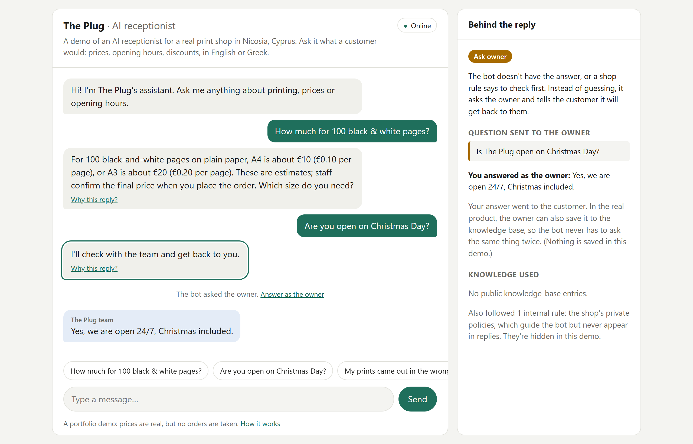

# Shop Assistant

An AI receptionist for small businesses, built for **The Plug**, a print shop next to the University of Nicosia, Cyprus. It answers customers from a knowledge base the owner maintains, asks the owner when it doesn't know, and hands complaints and negotiations to staff. It never guesses.

**[Try the live demo →](https://shop-assistant-ss1r.onrender.com)** Ask it what a customer would (prices, opening hours, discounts, in English or Greek) and see why it replied the way it did. When it asks the owner, you get to answer as the owner.

<sub>The demo runs on free hosting that sleeps when nobody's using it, so the first visit can take about a minute to wake up.</sub>



---

## How it works

Every customer message gets exactly one action:

| Action | When | What happens |
|---|---|---|
| `answer` | The knowledge base covers it | The bot replies, citing the knowledge entries it used |
| `ask_owner` | The bot doesn't know, but the owner would | The owner is asked, and their answer goes to the customer |
| `handoff` | Needs a person (complaints, refunds, negotiations, large orders) | A staff member takes over the chat |
| `no_reply` | A file or pasted text sent to print, not a question (chat apps only) | Left for staff; the bot stays quiet |

A few rules keep it trustworthy:

- **Answers must cite the knowledge base.** If the model can't point to a public entry that supports its answer, code turns the answer into a question for the owner. The model's own confidence is never trusted.
- **Public and internal knowledge.** Internal entries (the shop's private rules: when to escalate, what never to promise) guide the bot but never appear in a reply. The demo hides them from the decision panel too.
- **Business-agnostic.** Everything about the print shop lives in one markdown knowledge base (`kb/the-plug.md`); the code and prompts contain nothing shop-specific, and a test checks the prompt.
- **One bad response doesn't reach the customer.** The model's output is validated against a schema and the knowledge base; on a problem it gets one corrective retry, then a safe fallback.
- **The customer's language.** Replies come in English, Greek or Greeklish, while the knowledge base stays in English.

```
browser (chat page)  ──message + conversation so far──►  API (FastAPI)
                                                          ├─ rate limits
                                                          └─ brain: prompt + knowledge base ──► LLM
                     ◄──reply, action, public sources────    validate, check citations, retry once
```

## How the model was chosen

Before writing the bot, I built an evaluation set: now **130 labelled customer messages**, including the hard ones (typos, Greek and Greeklish, pasted homework that must not be answered, discount tricks, rude customers, multi-turn conversations). A runner scores every run by code: wrong actions, invented answers, internal leaks, wrong totals, language.

The brain talks to models through one thin interface, so the same eval ran on models from Anthropic, OpenAI and Google. All were safe (no invented prices, no leaked internal rules); **GPT-6 Luna** matched the best at a fraction of the cost and is the one in use:

- passes 125-127 of 130 cases, with the remaining misses judged acceptable by the shop owner
- about **$0.0003 per message**

Every significant design choice, and why it was made, is in **[DECISIONS.md](DECISIONS.md)**: 32 decisions, from the four actions to the model bake-off and the demo's scope.

## How it was built

I designed this project and made its decisions (the action model, the knowledge-base format, what the eval measures, every label and trade-off). The code was written with [Claude Code](https://claude.com/claude-code), one reviewed step at a time.

## Repository layout

```
├── DECISIONS.md      # Every architecture decision and its reasoning
├── kb/               # The print shop's knowledge base (markdown)
├── prompts/          # LLM prompts, kept as files so changes show up in diffs
├── brain/            # Schema, KB parser, model clients and the decision flow
├── eval/             # 130 eval cases, runner, scoring and run comparison (see eval/README.md)
├── app/              # The demo: FastAPI server, chat page, rate limits
├── onboarding/       # An interview that drafts a knowledge base from a conversation with the owner
├── tests/            # pytest tests (no API key needed)
└── render.yaml       # Hosting setup for the demo (Render, free plan)
```

## Running it locally

Needs Python 3.12+ and [uv](https://docs.astral.sh/uv/).

```
uv sync          # install dependencies
uv run pytest    # run the tests (no API key needed)

# The demo, at http://localhost:8000. Without DEMO_MODEL it calls no model and costs nothing.
uv run uvicorn app.main:app --reload
DEMO_MODEL=gpt-6-luna uv run --env-file .env uvicorn app.main:app

# The brain on one message (dry run unless --live)
uv run python -m brain --kb kb/the-plug.md "how much for 100 b&w pages"
uv run --env-file .env python -m brain --kb kb/the-plug.md --live --model gpt-6-luna "are you open now?"

# The eval (dry run by default) and run comparison
uv run --env-file .env python -m eval.run_eval --kb kb/the-plug.md --model gpt-6-luna --effort medium
uv run python -m eval.compare eval/results/A.json eval/results/B.json
```

Copy `.env.example` to `.env` and fill in a key for each provider you want to run (`ANTHROPIC_API_KEY`, `OPENAI_API_KEY`, `GEMINI_API_KEY`). The model name picks the provider: `claude-*`, `gpt-*` or `gemini-*`.

## Status

A portfolio project, not a live product. The bot and its eval are finished; the demo is live. Things a real deployment would add are listed in DECISIONS.md (D-031): WhatsApp/Viber channels, owner notifications on their phone, saving owner answers to the knowledge base, and a data-protection review.

## Data and privacy

The evaluation set is fully synthetic. Real customer messages were never committed. The demo stores nothing: the conversation lives in the visitor's browser, and the model provider is called with storage turned off.
