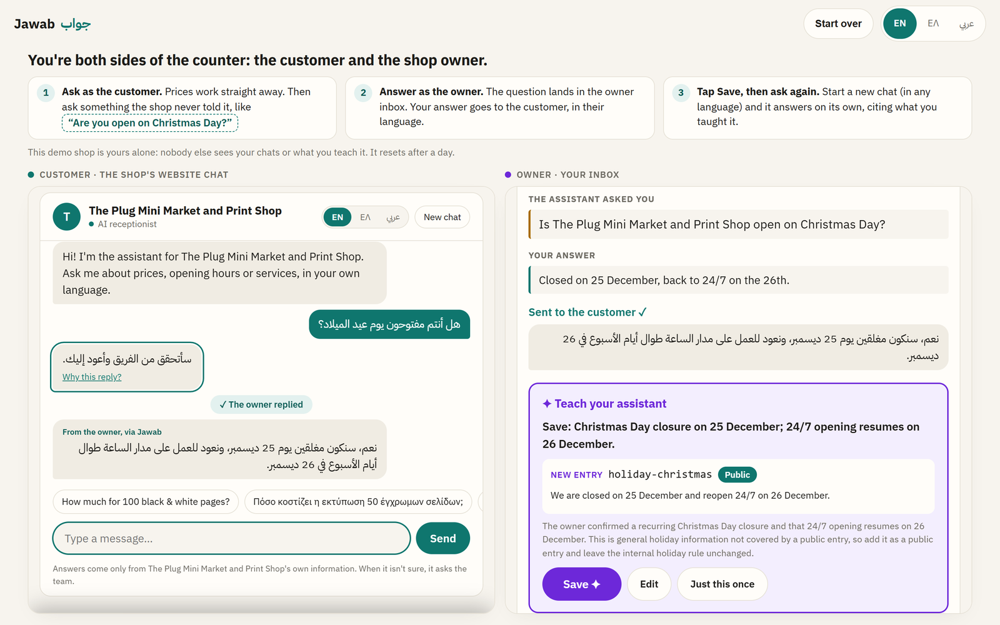

# Shop Assistant

The engine of an AI receptionist for small businesses, first built for **The Plug**, a print shop next to the University of Nicosia, Cyprus. It answers customers from a knowledge base the owner maintains, asks the owner when it doesn't know, learns from the owner's approved answers, and hands complaints and negotiations to staff. It never guesses.

**Used by [Jawab](https://github.com/zeinsaid/jawab)**, the product built on it: a multi-business AI receptionist in Arabic and English, with an owner inbox, one-tap learning and self-serve onboarding. Jawab installs this repo as a Python package.

**[Try it live in Jawab →](https://jawab.onrender.com/try)** You get a private copy of The Plug: chat as a customer, answer as the owner, and watch it learn.

<sub>The demo runs on free hosting that sleeps when nobody's using it, so the first visit can take about a minute to wake up.</sub>



---

## How it works

Every customer message gets exactly one action:

| Action | When | What happens |
|---|---|---|
| `answer` | The knowledge base covers it | The bot replies, citing the knowledge entries it used |
| `ask_owner` | The bot doesn't know, but the owner would | The owner is asked, and their answer goes to the customer |
| `handoff` | Needs a person (complaints, refunds, negotiations, large orders) | A staff member takes over the chat |
| `no_reply` | A file or pasted text sent to print, not a question (chat apps only) | Left for staff; the bot stays quiet |

A few rules keep it trustworthy:

- **Answers must cite the knowledge base.** If the model can't point to a public entry that supports its answer, code turns the answer into a question for the owner. The model's own confidence is never trusted.
- **Public and internal knowledge.** Internal entries (the shop's private rules: when to escalate, what never to promise) guide the bot but never appear in a reply. The demo hides them from the decision panel too.
- **Business-agnostic.** Everything about the print shop lives in one markdown knowledge base (`kb/the-plug.md`); the code and prompts contain nothing shop-specific, and a test checks the prompt.
- **One bad response doesn't reach the customer.** The model's output is validated against a schema and the knowledge base; on a problem it gets one corrective retry, then a safe fallback.
- **The customer's language.** Replies come in the customer's language (English, Greek or Greeklish for The Plug; Arabic and Arabizi in Jawab), while the knowledge base stays in English. Notes for a specific language switch on only for businesses that list it.
- **Learning with approval.** After the owner answers, one more model call writes the reply for the customer and drafts a knowledge entry; the owner chooses Save, Edit or Just this once, and nothing is saved without them.

```
browser (chat page)  ──message + conversation so far──►  API (FastAPI)
                                                          ├─ rate limits
                                                          └─ brain: prompt + knowledge base ──► LLM
                     ◄──reply, action, public sources────    validate, check citations, retry once
```

## How the model was chosen

Before writing the bot, I built an evaluation set: now **130 labelled customer messages**, including the hard ones (typos, Greek and Greeklish, pasted homework that must not be answered, discount tricks, rude customers, multi-turn conversations). A runner scores every run by code: wrong actions, invented answers, internal leaks, wrong totals, language.

The brain talks to models through one thin interface, so the same eval ran on models from Anthropic, OpenAI and Google. All were safe (no invented prices, no leaked internal rules); **GPT-6 Luna** matched the best at a fraction of the cost and is the one in use:

- passes 127-129 of 130 cases (rerun on 3 Nov 2026 with the v1.0.0 engine), with the remaining misses judged acceptable by the shop owner
- about **$0.0003 per message**

Every significant design choice, and why it was made, is in **[DECISIONS.md](DECISIONS.md)**: 33 decisions, from the four actions to the model bake-off, the demo's scope and the split into engine and product.

## Using the engine

```toml
# pyproject.toml of an app (this is how Jawab does it)
dependencies = ["shop-assistant[openai]"]     # or [anthropic], [gemini]

[tool.uv.sources]
shop-assistant = { git = "https://github.com/zeinsaid/Shop-Assistant", tag = "v1.0.0" }
```

```python
from brain.brain import Brain
from brain.kb import load_kb
from brain.llm import make_client
from brain.schema import IncomingMessage

brain = Brain(load_kb("kb/the-plug.md"), make_client("gpt-6-luna", effort="medium"), allow_no_reply=False)
result = brain.decide(IncomingMessage(text="are you open on christmas?"))
result.decision.action             # answer, ask_owner or handoff
result.decision.question_for_owner # when it's ask_owner

from brain.learn import Learner    # the owner's answer -> a reply for the customer + a draft KB entry
from onboarding.interview import Interview, interview_prompt   # draft a KB by interviewing the owner
```

The engine has no database and no web pages; storing conversations, the owner's inbox and approved entries is the app's job. The prompts ship inside the package (`brain/prompts/`, `onboarding/prompts/`), and every class that reads one also takes `prompt=` for an app's own version.

## How it was built

I designed and built this project, and made every decision in it: the action model, the knowledge-base format, what the eval measures, every label and trade-off. I worked with [Claude Code](https://claude.com/claude-code) as my AI pair programmer, reviewing every change step by step.

Then, at the Founding MENA x Replit Hackathon (Dubai, 31 Oct 2026), I built [Jawab](https://github.com/zeinsaid/jawab) on top of it in a day. The improvements that needed (Arabic, learning, a quick interview) came back into this repo, which became the installable engine ([D-033](DECISIONS.md)).

## Repository layout

```
├── DECISIONS.md      # Every architecture decision and its reasoning
├── kb/               # The print shop's knowledge base (markdown)
├── brain/            # Schema, KB parser, model clients, the decision flow and the learning call
│   └── prompts/      # Their prompts, kept as files so changes show up in diffs
├── onboarding/       # An interview that drafts a knowledge base from a conversation with the owner
│   └── prompts/
├── eval/             # 130 eval cases, runner, scoring and run comparison (see eval/README.md)
├── app/              # The original web demo (retired: Jawab is the live demo now)
├── tests/            # pytest tests (no API key needed)
└── render.yaml       # Hosting setup for the demo (Render, free plan)
```

## Running it locally

Needs Python 3.12+ and [uv](https://docs.astral.sh/uv/).

```
uv sync          # install dependencies (every provider, for the eval)
uv run pytest    # run the tests (no API key needed)

# The brain on one message (dry run unless --live)
uv run python -m brain --kb kb/the-plug.md "how much for 100 b&w pages"
uv run --env-file .env python -m brain --kb kb/the-plug.md --live --model gpt-6-luna "are you open now?"

# The eval (dry run by default) and run comparison
uv run --env-file .env python -m eval.run_eval --kb kb/the-plug.md --model gpt-6-luna --effort medium
uv run python -m eval.compare eval/results/A.json eval/results/B.json
```

Copy `.env.example` to `.env` and fill in a key for each provider you want to run (`ANTHROPIC_API_KEY`, `OPENAI_API_KEY`, `GEMINI_API_KEY`). The model name picks the provider: `claude-*`, `gpt-*` or `gemini-*`.

## Status

The engine is finished and released as **v1.0.0**; [Jawab](https://github.com/zeinsaid/jawab) uses it. Saving owner answers to the knowledge base is built (the learning call here, the inbox in Jawab). Things a real deployment would still add are listed in DECISIONS.md (D-031): WhatsApp/Viber channels, owner notifications on their phone, and a data-protection review.

## Data and privacy

The evaluation set is fully synthetic. Real customer messages were never committed. The model provider is called with storage turned off.
